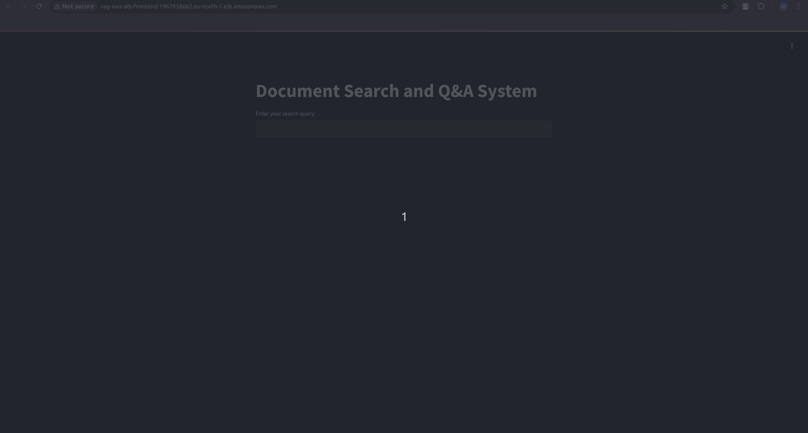
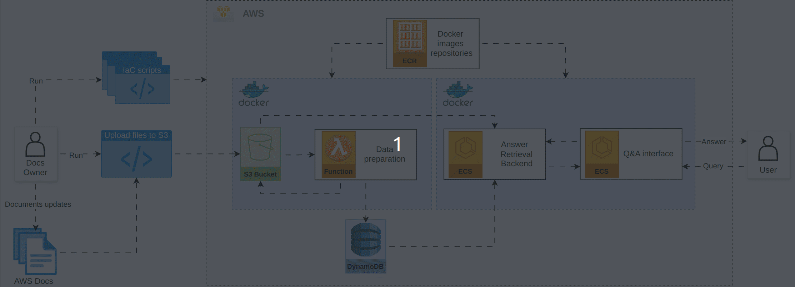

# Retrieval-Augmented Generation (RAG) for AWS Documentation Search

## Overview:

This project addresses the challenge of efficiently searching through a large dataset of documentation. Company X noticed their developers often spend too much time searching for documentation or asking other team members simple questions. We implemented a Proof of Concept (PoC) for a Retrieval-Augmented Generation (RAG) system, which uses an AWS-based architecture to significantly reduce the time required to retrieve relevant information from documents.

<p align="center">
  
</p>

## Solution to Pain Points:

The primary pain points we addressed:

1. **Time Consumption**: Developers spend a lot of time searching for specific documentation or interrupting others with queries.

2. **Updated Information**: In cases where documentation is frequently updated, team members might provide outdated information.

3. **Guidance for Further Learning**: Developers need pointers to additional documentation relevant to their current task.

We addressed these with:

1. **A Q&A interface**: Users can input questions directly, receiving real-time answers generated from the available documentation.

2. **Handles documents updates**: The system has a trigger implemented to run the processing function which will update the embeddings.

3. **Pointing to Sources**: The system returns the answer along with the source document for further reading.

## Architecture diagram

<p align="center">
  
</p>

## Architecture Rationale

The solution is AWS-based, leveraging scalability, cost-efficiency, and the secure environment that AWS offers. The architecture and workflow are depicted below:

1. **S3 Bucket**: Documents are uploaded to an S3 bucket and stored.

2. **Lambda Function**: A preprocessing service is triggered when new documents are uploaded, processing the documents and saving the chunked embeddings into DynamoDB and the FAISS index into S3.

3. **FAISS Index**: The FAISS index is stored in S3 for fast similarity search.

4. **Backend Services (ECS on Fargate)**: An API backend running on AWS ECS retrieves the most relevant document chunks using FAISS and returns the answers.

5. **Frontend (ECS on Fargate)**: A user-friendly Streamlit Q&A interface where users can input queries, get answers, and see the relevant document chunks.

6. **DynamoDB**: Stores document chunks and metadata to ensure fast and reliable retrieval.

## Running Locally

1. **Clone the Repository**:

    ```
    git clone https://github.com/yourrepo/RAG_AWS.git

    cd RAG_AWS
    ```

2. Ensure Docker and Docker compose are installed. [The steps can be seen here](./instructions/docker_setup.md)

3. For the full local experiment install Anaconda and create a python environment with the respective requirements. [The steps can be seen here](./instructions/anaconda_setup.md)

4. Run the step by step of notebooks from the solution first cycle

    1. Create a .env file with your OPENAI_API_KEY

    2. Run through the notebook 1.0-first-end-to-end-cycle.ipynb

    3. Run the Q&A interface script to test the knowledge base
        ```
        python 1.0-first-QA-interface.py
        ```

### Running the backend and frontend services locally with the documentation processing being already in AWS

The main idea is to test the feature to handle document updates already in AWS with a configured S3 event trigger, that triggers the Lambda function created to process each document, save the chunks, embeddings and the FAISS index. The backend and frontend are already containerized and ready to be cloud compatible.

1. Create a new IAM user and a new Access Key for local code through AWS Console

    - This will create the AWS Access Key ID and AWS Secret Access Key
    - Then run ```aws configure``` on your terminal and input the credentials 
     ```
        $ aws configure
        AWS Access Key ID [None]: <your-access-key-id>
        AWS Secret Access Key [None]: <your-secret-access-key>
        Default region name [None]: eu-north-1
        Default output format [None]: json
    ```
2. Attach the necessary policies to create and manage AWS resources

    ```
    ./scripts/attach_user_policies.sh <your-iam-user>
    ```

3. Create S3 bucket
    ```
    ./scripts/create_s3_bucket.sh <bucket-name> <region>
    ```
4. Create Dynamo Table with the script
    ```
    ./scripts/create_dynamo_table.sh <table-name> <region>
    ```
5. Build and Deploy a Lambda function with the docker image of the documentation processing function
    ```
    ./scripts/deploy_lambda_docker.sh <aws_region> <ecr_repo_name> <image_tag> <lambda_name> <role_name> <bucket_name>
    ```
    If the docker image suffered an update run the update lambda function script instead
    ```
    ./scripts/update_lambda_function.sh <aws_region> <ecr_repo_name> <image_tag> <lambda_name>
    ```

6. Upload the files to S3 to trigger Lambda function
    - This will create a trigger for the documentation processing function to start extracting and saving chunks, embeddings and the FAISS index in the Dynamo table and S3. 
        ```
        python ./scripts/upload_to_s3.py ../data/ aws-test-docs-loka sagemaker_documentation
        ```

7. Build and run the backend and frontend images
    ```
    cd rag_system

    docker-compose up --build
    ```

8. Access the frontend through http://localhost:8501

9. Make a query like "What is SageMaker?" and you will get the answer and a suggestion pointing out to further read the documentation from where the chat got the answer from.

To reproduce the full pipeline step by step and check what would the expected results be, you can check this [notebook](./rag_system/rag_aws_pipeline.ipynb).

## Deploying and running on AWS cloud services

1. Create the Backend and Frontend infrastructure

    - Check the [steps](./instructions/backend_frontend_AWS_infrastructure_setup.md) to create the infrastructure.

    - Working on the [script](./rag_system/deploy-rag-aws-infrastructure.sh) to create the infrastructure with AWS CLI commands and Docker commands.

2. Access the frontend interface through this URL http://rag-aws-alb-frontend-1967858662.eu-north-1.elb.amazonaws.com/  

## Next Steps

1. Build a model evaluation feature to monitor model performance
    
    - Proposal: Use metrics such as hit rate and the Mean Reciprocal Rank (MRR) to measure how high it ranked the most relevant information and how good the LLM is at putting the right answer near the top of the list, allowing a better validation for new approaches used on data preparation.

2. Select a better chunking technique

    - Proposal: Use the markdown syntax for headings and sub-headings, to separate the chunks.

3. Improve user's query with a specialized LLM model

    - Proposal: Utilize an LLM model to reformulate user question, optimizing queries for better understanding. Check gemma2-9b-it.

4. Improve the answer when the query is out of context

    - Proposal: If no source file is retrieved from backend, it generates a template answer saying it didn't find enough information to answer.

5. Build the infrastructure try to use IaC tools like Cloud Formation or Terraform

    - Enable a seamless and easier to maintain solution for the cloud infrastructure and production pipeline maintenance.

6. Select a better vector embedding storage database, which would be more appropriate for larger datasets

    - Proposal: Explore Pinecone, and others.

7. Handle sensitive internal documentation (if needed)

    - Proposal: 
        - Define external access rules on the VPN firewall 
            - The documentation cannot be accessed or shared externally
        - Define geographical restrictions
            - And it can’t leave the US data traffic 
        - ! Doesn’t have to be implemented for this POC with public data, but for a scenario where the data contains PII, it should be part of the first Data preparation phase. To confirm with the business team.

8. Data versioning and orchestrated ingestion

    - Proposal: It would have to be a solution for document editing that would trigger the document uploading script.

9. Collect users feedback to add to model monitoring


